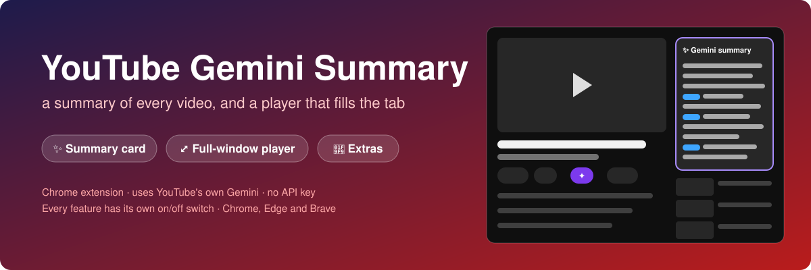

  

  

  <a href="#install">Install</a>
  &nbsp;·&nbsp; <a href="#what-you-get">What you get</a>
  &nbsp;·&nbsp; <a href="#how-it-works">How it works</a>
  &nbsp;·&nbsp; <a href="#settings">Settings</a>
  &nbsp;·&nbsp; <a href="#how-its-built">How it's built</a>

---

**YouTube Gemini Summary** is a Chrome extension. When you open a YouTube video, a summary
appears at the top of the right-hand column without you clicking anything. It gets the summary
from **YouTube's own Gemini** (the ✦ **Ask** button under each video), so you don't need an API
key or an account anywhere else.

## Install

| | Step | What you do |
|:-:|---|---|
| **1** | **Download** | Click the red button above, then unzip the file. |
| **2** | **Load it** | Open <code>chrome://extensions</code>, turn on **Developer mode** (top right), click **Load unpacked**, and choose the unzipped folder. |
| **3** | **Watch something** | Open any YouTube video. The ✨ **Gemini summary** card fills in after about 7 seconds. |

Works in Chrome, Edge and Brave (Edge uses <code>edge://extensions</code>). To update, download
the zip again, replace the folder, and click ↻ on the extension's card in the extensions page.

## What you get

- **A summary of every video.** It also updates when you click on to the next video, not just on
  a fresh page load.
- **Clickable timestamps.** Times in the summary, like `3:15`, jump the video to that moment.
- **↻ Regenerate · ⧉ Copy · ▾ Collapse** buttons on the card.
- **Instant on rewatch.** Each summary is saved, so a video you've seen before shows its summary
  straight away.

> It only reads the answer YouTube gives. It never likes, comments, subscribes or changes
> anything on your account.

## How it works

YouTube already has Gemini built in: the ✦ **Ask** button opens an "Ask about this video" panel
with a **Summarize the video** option. The extension does those two clicks for you:

1. **Wait for the page.** YouTube switches videos without reloading the page, so the extension
   listens for YouTube's own navigation event and starts again on each new video.
2. **Ask, out of sight.** It clicks ✦ Ask while the panel is moved off-screen, so you don't see it
   pop open, then clicks **Summarize the video**.
3. **Know when the answer is finished.** Gemini writes the answer a bit at a time. The extension
   waits until the 👍/👎 row appears under the answer, which YouTube only adds once the answer
   is complete. As a backup, it also accepts the answer once the text stops changing for 4
   seconds.
4. **Copy it safely.** The answer is rebuilt as plain text, paragraphs, lists, bold and timestamp
   links. Nothing else from YouTube's markup is copied. Then the Ask panel is closed again.

If you click on to another video halfway through, the old request is dropped, so a summary never
lands on the wrong video.

## Settings

Click the extension's icon in the toolbar.

| Setting | What it does |
|---|---|
| **Summary from** | **YouTube's own Gemini** (default, no key needed), or **Gemini API** with your own prompt. |
| **Gemini API key** | Optional. Free from [aistudio.google.com/apikey](https://aistudio.google.com/apikey). A Gemini Pro subscription doesn't include API access. |
| **Model** | `gemini-flash-latest` by default. **List models** shows every model your key can use. |
| **Summarise automatically** | Turn this off to get a *Summarise this video* button instead. |
| **API prompt** | Used in API mode. By default it asks for 3–4 paragraphs of prose. |
| **Clear cached summaries** | Forgets every saved summary. |

**API mode** is there for when you want your own format, or for videos that have no Ask button
(YouTube doesn't offer it everywhere). If a key is set, YouTube mode falls back to the API
automatically. In API mode the extension reads the transcript from YouTube's *Show transcript*
panel and sends it to Gemini. If a video has no transcript, it sends the video link instead and
Gemini watches the video itself, which is slower (30–60 s).

## How it's built

| Part | File | Size |
|---|---|---|
| **Card on the page** — adds the card, reacts to navigation, caches, shows results | `content.js` | ~180 lines |
| **YouTube Ask driver** — clicks Ask → Summarize, waits for the answer, copies it safely | `youchat.js` | ~100 lines |
| **Transcript reader** — opens *Show transcript*, reads the lines, closes it (API mode) | `transcript.js` | ~80 lines |
| **Gemini API call** — runs in the extension's background worker (API mode) | `background.js` | ~55 lines |
| **Settings page** | `options.html` · `options.js` · `defaults.js` | ~110 lines |
| **Styles** — follows YouTube's light/dark theme colours | `panel.css` | ~35 lines |

Plain JavaScript with no framework, no libraries and no build step. It uses Chrome's Manifest V3,
and the only permission it asks for is `storage`, for settings and saved summaries. The API
host is listed only for the optional API mode.

**Why it clicks buttons instead of calling an API.** YouTube's transcript endpoints refuse
requests made outside YouTube's own player code, even from a logged-in tab (as of November
2026). Driving YouTube's own panels is the approach that keeps working, and it means the
default mode needs no key at all.

**If it stops working.** It depends on YouTube's page layout. If YouTube renames the Ask button
or the panel, the selectors to update are all in one place: `YTGS.ASK` at the top of
`youchat.js`.
