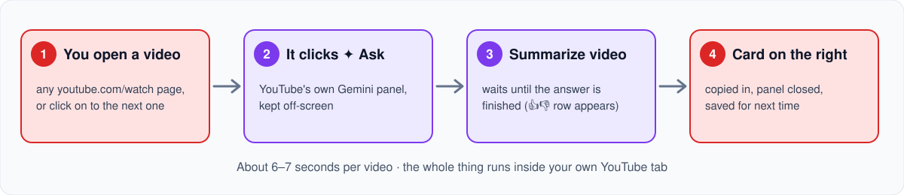
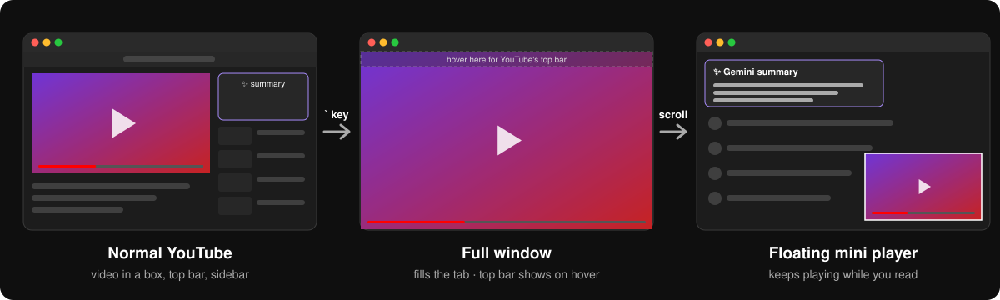
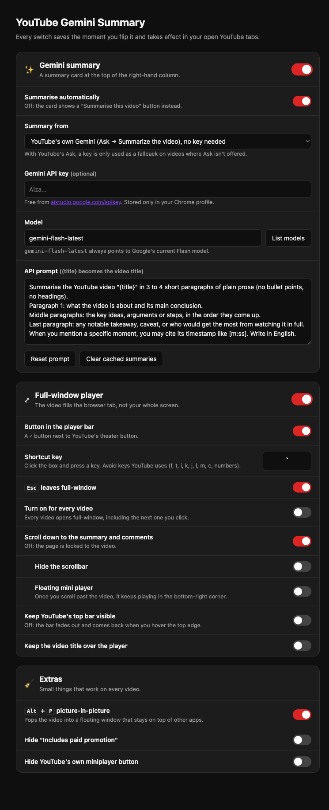

  

  

  <a href="#install">Install</a>
  &nbsp;·&nbsp; <a href="#-the-summary-card">Summary card</a>
  &nbsp;·&nbsp; <a href="#-the-full-window-player">Full-window player</a>
  &nbsp;·&nbsp; <a href="#-extras">Extras</a>
  &nbsp;·&nbsp; <a href="#every-switch">Every switch</a>
  &nbsp;·&nbsp; <a href="#how-its-built">How it's built</a>

---

Two things about watching YouTube on a computer are annoying. A 40-minute video might hold three
minutes you actually need. And the player is either a small box surrounded by clutter, or true
fullscreen that takes over your whole monitor.

**YouTube Gemini Summary** is a small Chrome extension that fixes both:

- **✨ A summary of every video**, at the top of the right-hand column, before you press play.
  It comes from **YouTube's own Gemini**, so you don't need an API key or another account.
- **⤢ A full-window player.** The video fills the **browser tab**, not the monitor. Your other
  windows stay where they are, and you can still scroll down to the summary and comments.

Every feature has its own **on/off switch**, so you can keep only the parts you like.

## Install

| | Step | What you do |
|:-:|---|---|
| **1** | **Download** | Click the red button above, then unzip the file. |
| **2** | **Load it** | Open <code>chrome://extensions</code>, turn on **Developer mode** (top right), click **Load unpacked**, and choose the unzipped folder. |
| **3** | **Watch something** | Open any YouTube video. The ✨ card fills in after about 7 seconds, and the ⤢ button appears in the player bar. |

Works in Chrome, Edge and Brave (Edge uses <code>edge://extensions</code>). To update, download
the zip again, replace the folder, and click ↻ on the extension's card in the extensions page.
Click the extension's toolbar icon to open its settings.

---

## ✨ The summary card

Open a video and a **Gemini summary** card appears at the top of the right-hand column. You get
the gist in a few seconds and can decide whether the video is worth your next 40 minutes.

- **Follows you.** Click on to the next video and the card updates too, without a page reload.
- **Clickable timestamps.** A time in the summary, like `3:15`, jumps the video to that moment.
- **↻ Regenerate · ⧉ Copy · ▾ Collapse** buttons on the card.
- **Instant on rewatch.** Each summary is saved, so a video you've seen before shows its summary
  straight away.

**How it gets the summary.** YouTube already has Gemini built in: the ✦ **Ask** button under a
video opens an "Ask about this video" panel with a **Summarize the video** option. The extension
does those two clicks for you, out of sight:

1. **Wait for the page.** YouTube switches videos without reloading the page, so the extension
   listens for YouTube's own navigation event and starts again on each new video.
2. **Ask, out of sight.** It clicks ✦ Ask while the panel is moved off-screen, so you don't see it
   pop open, then clicks **Summarize the video**.
3. **Know when the answer is finished.** Gemini writes the answer a bit at a time. The extension
   waits for the 👍/👎 row, which YouTube only adds under a finished answer. As a backup, it also
   accepts the answer once the text stops changing for 4 seconds.
4. **Copy it safely.** Only plain text, paragraphs, lists, bold and timestamp links are copied
   from YouTube's markup. Then the Ask panel is closed again.

If you click on to another video halfway through, the old request is dropped, so a summary never
lands on the wrong video.

> It only reads the answer YouTube gives. It never likes, comments, subscribes or changes
> anything on your account.

**Want your own format?** Switch *Summary from* to **Gemini API** and add a free key from
[aistudio.google.com/apikey](https://aistudio.google.com/apikey). The extension then reads the
video's transcript and sends it to Gemini with your own prompt. If a video has no transcript,
Gemini watches the video itself, which takes longer (30–60 s). With a key set, YouTube mode also
falls back to the API on videos where YouTube doesn't offer Ask.

---

## ⤢ The full-window player

YouTube gives you three sizes: a small box, theater mode (wider, but still with the page around
it), and fullscreen (the whole monitor, so you can't glance at anything else). **Full window**
is the missing fourth size: the video fills the browser tab exactly, edge to edge.

| To… | Do this |
|---|---|
| Go full window | Click **⤢** in the player bar (next to the theater button), or press <kbd>`</kbd> |
| Come back | Press <kbd>`</kbd> again, click **⤡**, or press <kbd>Esc</kbd> |
| Reach the search bar | Move the mouse to the top edge and YouTube's bar fades back in |
| Read the summary or comments | Just scroll down; the page is still there under the video |

Things it gets right:

- **Remembers your layout.** If you weren't in theater mode before, you aren't after you leave.
- **Stays on.** With *Turn on for every video*, the next video you click opens full window too.
- **Steps aside for real fullscreen.** Press <kbd>f</kbd> as usual; the ⤢ button hides while
  you're in fullscreen.
- **Never steals your typing.** The shortcut is ignored while you type in search or comments.
- **Floating mini player (optional).** Scroll past the video and it shrinks into the
  bottom-right corner and keeps playing while you read. Hover it for **Go to top**, or
  **Hide** to tuck it down to a thin strip you can click to bring back.

**How it works.** No video is copied or re-encoded. The extension switches YouTube into its own
theater mode, then uses a few CSS rules to stretch the player to the full height of the tab and
fade the top bar. YouTube's player is told the window resized, so it re-scales the picture
itself. Leaving full window removes those rules.

---

## 🧹 Extras

Small things that work on every video, whether full window is on or not:

- **<kbd>Alt</kbd> + <kbd>P</kbd> picture-in-picture.** Pops the video into a floating window that
  stays on top of every app, for when you're working in something else.
- **Hide "Includes paid promotion".** Removes that overlay from the start of sponsored videos.
- **Hide YouTube's own miniplayer button**, if you keep clicking it by accident.

---

## Every switch

Click the extension's toolbar icon. Each switch **saves as soon as you flip it** and applies to
the YouTube tabs you already have open; there's no Save button and no reload.

| Switch | Default | What it does |
|---|:-:|---|
| **✨ Gemini summary** (master) | On | Turns the whole summary card on or off. |
| Summarise automatically | On | Off: the card shows a *Summarise this video* button instead. |
| Summary from | YouTube | **YouTube's own Gemini** (no key) or **Gemini API** with your own prompt. |
| Gemini API key | – | Optional. Free from [aistudio.google.com/apikey](https://aistudio.google.com/apikey). A Gemini Pro subscription doesn't include API access. |
| Model | `gemini-flash-latest` | **List models** shows every model your key can use. |
| API prompt | 3–4 paragraphs | Used in API mode. `{title}` becomes the video title. |
| **⤢ Full-window player** (master) | On | Turns the button, the shortcut and every option below on or off. |
| Button in the player bar | On | The ⤢ button next to the theater button. |
| Shortcut key | <kbd>`</kbd> | Click the box and press any letter, symbol or F-key. |
| <kbd>Esc</kbd> leaves full window | On | |
| Turn on for every video | Off | Every video opens full window. |
| Scroll down to the summary and comments | On | Off: the page is locked to the video. |
| ↳ Hide the scrollbar | Off | Scroll still works; the bar is just invisible. |
| ↳ Floating mini player | Off | Video keeps playing in the corner once you scroll past it. |
| Keep YouTube's top bar visible | Off | Off: the bar fades out and returns when you hover the top edge. |
| Keep the video title over the player | Off | |
| **🧹** <kbd>Alt</kbd>+<kbd>P</kbd> picture-in-picture | On | |
| **🧹** Hide "Includes paid promotion" | Off | |
| **🧹** Hide YouTube's miniplayer button | Off | |

**Clear cached summaries** forgets every saved summary.

---

## How it's built

| Part | File | Size |
|---|---|---|
| **Summary card**: adds the card, reacts to navigation, caches, shows results | `content.js` | ~190 lines |
| **YouTube Ask driver**: clicks Ask → Summarize, waits for the answer, copies it safely | `youchat.js` | ~100 lines |
| **Transcript reader**: opens *Show transcript*, reads the lines, closes it (API mode) | `transcript.js` | ~80 lines |
| **Gemini API call**: runs in the extension's background worker (API mode) | `background.js` | ~55 lines |
| **Full-window player**: player-bar button, shortcuts, theater → full-tab stretch, mini player, extras | `fullwindow.js` · `fullwindow.css` | ~185 + ~85 lines |
| **Settings page**: switches that save instantly | `options.html` · `options.js` · `defaults.js` | ~280 lines |
| **Card styles**: follow YouTube's light/dark theme colours | `panel.css` | ~35 lines |

Plain JavaScript with no framework, no libraries and no build step. It uses Chrome's Manifest V3,
and the only permission it asks for is `storage`, for settings and saved summaries. The Gemini
API host is listed only for the optional API mode. Nothing is sent anywhere else.

**Why it clicks buttons instead of calling an API.** YouTube's transcript endpoints refuse
requests made outside YouTube's own player code, even from a logged-in tab (as of November
2026). Driving YouTube's own panels is the approach that keeps working, and it means the
default mode needs no key at all.

**If something stops working.** Everything depends on YouTube's page layout, which changes now
and then. The selectors to update are in one place for each feature:

- Summary: `YTGS.ASK` at the top of `youchat.js`.
- Full window: the `#full-bleed-container` / `#movie_player` rules in `fullwindow.css`, and the
  `.ytp-size-button` (theater button) lookup in `fullwindow.js`.

The README images are generated by `python3 docs/gen_svgs.py`.
